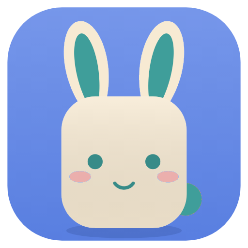

# Tokkip Phone

**Tu Android y tu PC, como uno solo, con Tokkip.**

Notificaciones, mensajes, llamadas, portapapeles, archivos, fotos, espejo de
pantalla y las apps del teléfono en ventanas, entre Android y Windows. Sin
cuenta y sin nube: todo va directo entre tus dispositivos, cifrado.

Es la versión personal de Andy (LoperStack) dentro de la familia Tokkip
(Tokkip para Android y Wear OS, Tokkip PC, Tokkip Notas, Tokkip Healthy PC).

## De dónde viene

Tokkip Phone está basado en [NectarLink](https://github.com/thtbee/nectarlink)
de Bee: su motor (el núcleo en Rust, el protocolo cifrado, el espejo de
pantalla, la cámara virtual) se queda; lo que se ve es de Tokkip (diseño,
nombre, Tokkip mismo y el español). NectarLink es software libre bajo la
GPL 3.0 (las apps) y la MPL 2.0 (el núcleo), y Tokkip Phone sigue bajo esas
mismas licencias: ver [LICENSE](LICENSE). El nombre y el logo de NectarLink
son de su proyecto ([TRADEMARKS.md](TRADEMARKS.md)); Tokkip Phone usa los
suyos.

## Compilar

- Windows: ver [CONTRIBUTING.md](CONTRIBUTING.md) (Rust, Qt 6.12 y NSIS).
- Android: `cd android && ./gradlew assembleRelease` (necesita el NDK).
- La compilación en GitHub (Actions) arma el instalador de Windows y el APK.
